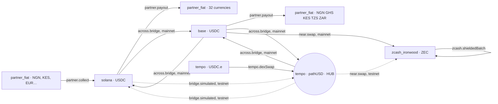

The planner (`@corridor/routing`) turns a request into an ordered list of legs. It is pure: no I/O, fully unit-tested, and the only place a route is decided.

## The graph

Nodes are positions (`venue` + `asset`). Edges are legs Corridor can execute, each with a cost and, where relevant, the environments it exists in.



| Leg kind | From → to | Environments |
|---|---|---|
| `tempo.dexSwap` | tempo/USDC.e → tempo/pathUSD | both |
| `across.bridge` | tempo/pathUSD ⇄ base/USDC ⇄ solana/USDC | mainnet |
| `bridge.simulated` | tempo/pathUSD ⇄ solana/USDC | testnet (Across has no Tempo testnet) |
| `partner.collect` | `partner_fiat/{11 currencies}` → `solana/USDC` | both |
| `partner.payout` | `solana/USDC` → `partner_fiat/{32 currencies}` | both |
| `partner.payout` | `base/USDC` → `partner_fiat/{BASE_PAYOUT_CURRENCIES}` | both; empty today, for partners that settle on Base |
| `near.swap` | base/USDC → zcash_ironwood/ZEC | mainnet (NEAR Intents has no Tempo market) |
| `near.swap` | tempo/pathUSD → zcash_ironwood/ZEC | testnet |
| `zcash.shieldedBatch` | zcash_ironwood/ZEC → zcash_ironwood/ZEC | both, appended to shielded payouts |

## Planning

```ts
planRoute({
  corridor: "EUR-NGN",
  purpose: "payout",
  privacy: "public",
  source: { venue: "tempo", asset: "pathUSD" },
  destination: { venue: "partner_fiat", asset: "NGN" },
  env: "mainnet",
});
// ledger.reserve → across.bridge (tempo→base) → partner.payout (base→NGN)
```

<Steps>
  <Step title="Validate">
    Payouts must be funded from the hub; collections must land on it and are always public; a shielded payout must end in a shielded venue, and a public one must not.
  </Step>
  <Step title="Search">
    Cheapest path over the edges available in the requested environment. The batch leg is excluded from search and appended explicitly.
  </Step>
  <Step title="Bracket">
    Payouts start with `ledger.reserve` (move the amount into the customer's hold); collections end with `ledger.credit` (credit the customer's hub balance). Shielded payouts end with `zcash.shieldedBatch`.
  </Step>
  <Step title="Scope references">
    Each step gets a reference scope (payout, batch or item), so a shielded batch uses one batch reference on the funding legs and an item reference per recipient output.
  </Step>
</Steps>

## Resulting routes

| Flow | Testnet | Mainnet |
|---|---|---|
| EUR → NGN payout | reserve → bridge.simulated → partner.payout | reserve → across (Tempo→Base) → across (Base→Solana) → partner.payout |
| NGN → CNY payout | reserve → bridge.simulated → partner.payout | reserve → across (Tempo→Base) → across (Base→Solana) → partner.payout |
| NGN collection | partner.collect → bridge.simulated → ledger.credit | partner.collect → across (Solana→Base) → across (Base→Tempo) → ledger.credit |
| Shielded supplier batch | reserve → near.swap → zcash.shieldedBatch | reserve → across (Tempo→Base) → near.swap → zcash.shieldedBatch |

<Note>
Payouts through partners that settle on Solana, including Paj for naira, take **two hops** through Base, because Across has no direct Tempo ↔ Solana route. A partner that settles on Base would cut that to one hop with a config change.
</Note>
