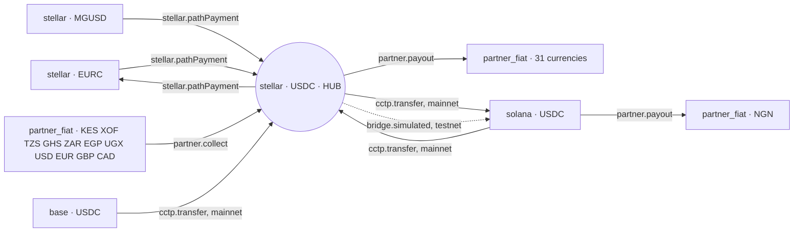

The planner (`@corridor/routing`) turns a request into an ordered list of legs. It is pure: no I/O, fully unit-tested, and the only place a route is decided.

## The graph

Nodes are positions (`venue` + `asset`). Edges are legs Corridor can execute, each with a cost and, where relevant, the environments it exists in.



| Leg kind | From → to | Environments |
|---|---|---|
| `partner.payout` | `stellar/USDC` → `partner_fiat/{31 currencies}` | both — the anchor is on the hub, so there is nothing in between |
| `partner.collect` | `partner_fiat/{11 currencies}` → `stellar/USDC` | both |
| `stellar.pathPayment` | `stellar/{EURC, MGUSD}` ⇄ `stellar/USDC` | both — on-ledger FX over Stellar's own order books |
| `cctp.transfer` | `stellar/USDC` ⇄ `base/USDC`, `solana/USDC` | mainnet — **declared, not built** |
| `bridge.simulated` | `stellar/USDC` ⇄ `solana/USDC` | testnet; the Stellar side is real |
| `partner.payout` | `solana/USDC` → `partner_fiat/NGN` | both — the one currency whose licensed partner settles off Stellar |
| `partner.collect` | `partner_fiat/NGN` → `solana/USDC` | both |

`OFF_STELLAR_PAYOUT_CURRENCIES` is the single list that decides which currencies need a hop off the hub. Today it is `["NGN"]`.

## Planning

```ts
planRoute({
  corridor: "EUR-KES",
  purpose: "payout",
  privacy: "public",
  source: { venue: "stellar", asset: "USDC" },
  destination: { venue: "partner_fiat", asset: "KES" },
  env: "testnet",
});
// ledger.reserve → partner.payout
```

<Steps>
  <Step title="Validate">
    Payouts must be funded from the hub; collections must land on it and are always public. A shielded payout is refused outright, because `SHIELDED_VENUES` is empty — *"no shielded venue is available: the confidential lane is not live yet"* ([ADR 0005](/decisions/0005-confidential-lane-deferred)).
  </Step>
  <Step title="Search">
    Cheapest path (Dijkstra) over the edges available in the requested environment. Graphs are small, so a linear scan is fine.
  </Step>
  <Step title="Bracket">
    Payouts start with `ledger.reserve`, which moves the amount into the customer's hold; collections end with `ledger.credit`, which credits the customer's hub balance.
  </Step>
  <Step title="Scope references">
    Each step gets a reference scope (payout, batch or item), so a future batch can use one batch reference on its funding legs and an item reference per recipient.
  </Step>
</Steps>

## Resulting routes

| Flow | Testnet | Mainnet |
|---|---|---|
| EUR → KES payout | `reserve → partner.payout` | `reserve → partner.payout` |
| Funded in EURC | `reserve → stellar.pathPayment (EURC → USDC) → partner.payout` | same |
| KES collection | `partner.collect → ledger.credit` | same |
| EUR → NGN payout | `reserve → bridge.simulated (Stellar → Solana) → partner.payout` | `reserve → cctp.transfer (Stellar → Solana) → partner.payout` |
| NGN collection | `partner.collect → bridge.simulated (Solana → Stellar) → ledger.credit` | `partner.collect → cctp.transfer → ledger.credit` |

<Note>
The common payout route has **two steps and no bridge**. That is the point of settling where the anchors are: the only corridor that leaves the hub is the one whose licensed partner has not arrived on it yet.
</Note>

## Hub enforcement is tested

```ts
// packages/routing/src/routing.test.ts
expect(() => planRoute({ ...req, source: { venue: "solana", asset: "USDC" } }))
  .toThrow(NoRouteError);
```

Eleven tests cover hub enforcement, every route shape above, the shielded refusal and the off-Stellar list. See [ADR 0002](/decisions/0002-hub-enforced-by-planner).
