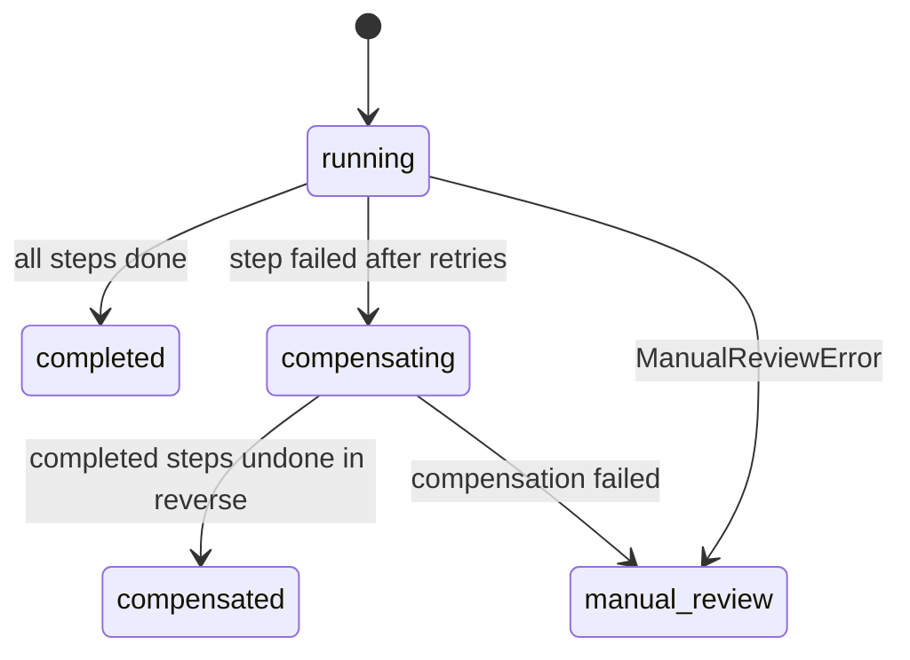

Banks and blockchains do not take part in distributed transactions, so a cross-border payment cannot be one atomic commit. Corridor runs each plan as a **saga**: a sequence of legs, each with a compensating action, persisted in Postgres so it survives crashes. See [ADR 0004](/decisions/0004-saga-over-two-phase-commit).

<Frame caption="Fig. 07 · Forward legs, a failure at the partner, and compensation in reverse order with an on-chain refund.">
  
  
</Frame>

## The leg contract

```ts
interface Leg<D> {
  kind: LegKind;
  forward(ctx: LegContext<D>): Promise<LegOutcome>;
  compensate?(ctx: LegContext<D>, output: Json): Promise<LegOutcome>;  // omit if nothing to undo
  maxAttempts?: number;
  backoffMs?: number;
}

interface LegOutcome {
  output: Json;              // stored on the step; passed to later steps and to compensate()
  bookings?: EntryInput[];   // posted to the ledger after the leg succeeds
}
```

Every call gets an `idempotencyKey` of `${sagaId}:${stepIndex}`. Bookings without an external reference are keyed on it, so re-running a step never double-books. Legs that move money first look for the movement by its Corridor Reference, so a retry after a crash between "sent" and "recorded" finds the transfer instead of sending it again.

## State

```sql
sagas       (id, kind, reference, status, input, lease_owner, lease_until)
saga_steps  (saga_id, idx, kind, status, attempts, output, error)
saga_events (saga_id, idx, event, detail, at)       -- the audit trail shown in the console
```



## Failure semantics

<AccordionGroup>
  <Accordion title="Retryable errors" icon="rotate-ccw">
    The step is retried up to `maxAttempts` with backoff. Network errors and RPC timeouts land here.
  </Accordion>
  <Accordion title="NonRetryableError" icon="circle-x">
    The step fails at once (a validation that a retry cannot change), and the saga compensates.
  </Accordion>
  <Accordion title="Compensation, in reverse order" icon="undo-2">
    Completed steps are undone from last to first, each through its own `compensate` with its own bookings. Order matters: unwinding out of order can leave a balanced ledger with a false audit trail. A forced partner failure on testnet refunds the Tempo leg on-chain and reverses every booking.
  </Accordion>
  <Accordion title="ManualReviewError" icon="hand">
    No retries and no automatic compensation. Used when money has already left Corridor's control, for example a partner rejecting a payout it was already funded for. Undoing earlier legs would be wrong until the partner's refund is confirmed, so a human closes it.
  </Accordion>
</AccordionGroup>

## Leases

A saga is driven by one worker at a time. `run()` takes a lease (`lease_owner`, `lease_until`, default 120 s) with a conditional update; another live worker that tries gets the current status back without doing work. If a worker dies, its lease expires and any worker can resume from the last durable step.

### Fencing tokens

Every lease carries a **fencing token** (`sagas.fence`). A renewal by the live holder keeps it; any takeover (another worker, or the same worker after its lease lapsed) increments it. Every commit runs inside a transaction that first checks the token:

- ledger bookings, through the ledger's `precondition` hook;
- step results (`done`, `failed`, `compensated`) and saga status changes.

So a worker that stalls inside a leg, loses its lease and wakes up later is refused at its next commit with `StaleLeaseError`, writes nothing, and returns the saga's real status. The chain side is covered separately: legs find their own earlier transfers by memo, so a repeated call never moves money twice. A test runs exactly this race (a worker stalled past its lease while a second worker completes the saga) and checks that only one booking exists; with fencing disabled the same test finds two.

## Fault injection

`SagaInput.faults.failAt` makes a chosen leg kind fail, which is how the test flows prove compensation on-chain. The console button "Payout with partner failure" uses it; see [Failure and compensation](/flows/failure-and-compensation).
