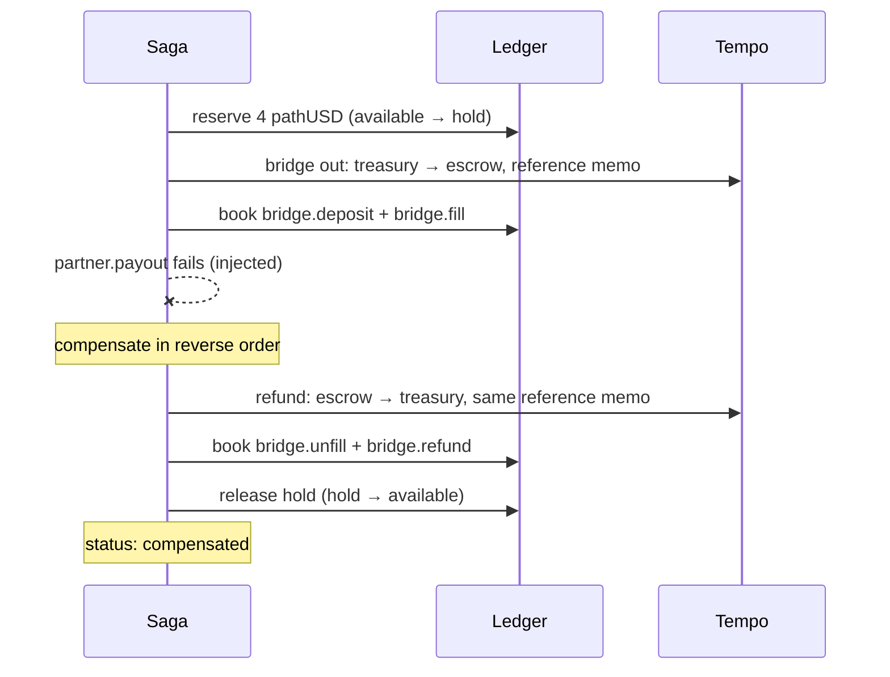

Payments fail. What matters is where the money is afterwards, and whether the books say so. This walkthrough is the console action **Payout with partner failure**, which injects a failure at `partner.payout` (`faults.failAt`). It ran three times on testnet; each run compensated cleanly.

## The run

EUR → NGN, 4 pathUSD, recorded on 29 September 2026:

<Frame caption="Fig. 07 · Forward legs, a failure at the partner, and compensation in reverse order with an on-chain refund.">
  
  
</Frame>

| Step | Forward | Compensation |
|---|---|---|
| `ledger.reserve` | Available → hold | Hold → available (`payout.release`) |
| `bridge.simulated` | Treasury → escrow on Tempo ([0xb13fd060…](https://explore.testnet.tempo.xyz/tx/0xb13fd06043c4647bbcdeb9e53313f02f845443e8ddcd17a57a468758a8ae229d)) | Escrow → treasury refund ([0x67790303…](https://explore.testnet.tempo.xyz/tx/0x6779030377fb90884212fa7f5d3acc681958856b7ce22406862f7d2e0940c944)) |
| `partner.payout` | **Failed** | Nothing to undo |

## Why reverse order

Compensations run from the last completed step to the first. Unwinding the hold before the bridge refund would let the customer's balance show funds that are still in the escrow, and the ledger would balance while describing a sequence that never happened. In reverse order, every intermediate state is one that really existed.

## When not to compensate

If the partner fails **after** it was funded, the money is at the partner, not with Corridor. Reversing Corridor's books at that point would be wrong until the partner's refund is confirmed, so the payout leg throws `ManualReviewError`: no retries, no automatic compensation, and the saga waits in `manual_review` for a person to close it against the partner's refund.

## The result

| | Before | After |
|---|---|---|
| Customer available | X | X |
| Customer hold | 0 | 0 |
| Treasury vault on Tempo | Y | Y (refund received) |
| Saga status | | `compensated` |

The Tempo deposit and its refund both carry the payout's reference, so reconciliation matches both movements to the forward and compensating entries.
