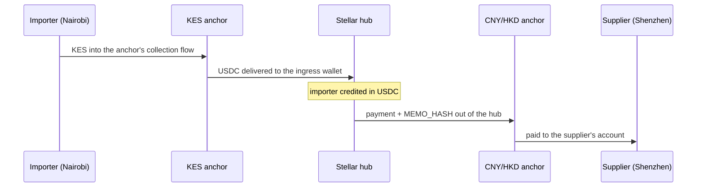

An importer in Nairobi owes a supplier in Shenzhen. Through Corridor this is a **collection** into the hub followed by a **payout** out of it: two sagas joined by the importer's USDC balance on Stellar.

<Warning>
The payout half runs today, in the shape [EUR → KES](/flows/payout-eur-kes) walks through. The collection half **does not**: SEP-6 deposits are [unimplemented](/integrations/sep-anchors#what-is-not-built), and no collecting anchor is signed. This page describes the design and says where it stops.
</Warning>

## 1. Collection: shillings into the hub

| Step | What happens | Status |
|---|---|---|
| `partner.collect` | The anchor opens a deposit, the importer pays local currency through its rail, and the anchor delivers USDC to Corridor's ingress account on Stellar | **Not built.** `openCollection` checks the anchor publishes a `TRANSFER_SERVER` and then raises, rather than guessing at a SEP-6 flow no signed anchor has exercised |
| `ledger.credit` | The importer's balance on the hub is credited in USDC | Built |

The route is `partner.collect → ledger.credit`: because the anchor settles on Stellar, the delivery **is** the arrival on the hub. There is no bridge between collecting and being credited.

## 2. Payout: yuan to the supplier

| Step | What happens | Status |
|---|---|---|
| `ledger.reserve` | The amount moves into the importer's hold | Built |
| `partner.payout` | SEP-38 quote, SEP-31 order, one Stellar payment funding it exactly once, polled to completion | Built, against a stubbed and a mock anchor |

Onshore CNY conversion is restricted, so most China trade settles in **USD or HKD to a Hong Kong or offshore account**. The payout spoke is whichever licensed anchor pays that rail; the hub does not change, and neither does anything else in this page.

## Why the shape matters

- **The importer never holds a dollar account abroad.** Their balance sits on the hub between the two halves.
- **The two halves are independent.** Collect when shillings are available; pay when the invoice is due; pay several suppliers from one collection.
- **The corridor needs no code.** `KES-CNY` is just a currency pair, and the pair is encoded in the reference, so no registry changes when a new one opens.
- **Compliance stays with the licensed customer.** Invoice numbers and any FX permission references ride in the saga data and the reconciliation trail.

## What would make this real

One signed collecting anchor and the SEP-6 deposit flow behind `openCollection`. Both are on the [roadmap](/status/roadmap); neither is written. Until then the honest claim is the payout half, which [has run on testnet](/status/evidence#stellar-testnet).
