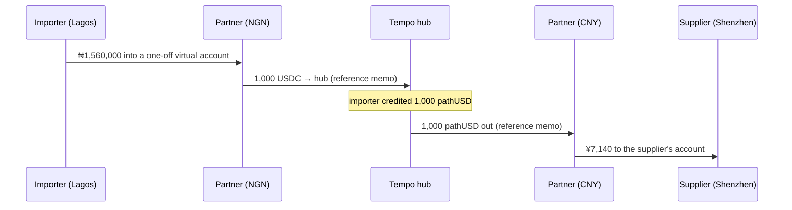

An importer in Lagos owes a supplier in Shenzhen. Through Corridor this is a **collection** into the hub followed by a **payout** out of it, two sagas joined by the importer's pathUSD balance. Recorded on testnet on 29 September 2026: **₦1,560,000 → 1,000 USDC → ¥7,140**.

## 1. Collection: naira into the hub

| Step | What happens | Evidence |
|---|---|---|
| `partner.collect` | A collection order returns a **one-off virtual bank account**. The importer pays ₦1,560,000 from their bank app; the partner delivers 1,000 USDC (at 1,560 NGN/USD) to Corridor's ingress wallet | Signed webhook |
| `bridge.simulated` (testnet) | The USDC crosses into the hub: pathUSD arrives at the treasury with the reference as memo | [0x100fde2c…](https://explore.testnet.tempo.xyz/tx/0x100fde2c5d68f4eeb38e1fb4993abae78960023c1a3ab3f6a2b96289901961b0) |
| `ledger.credit` | The importer's hub balance is credited 1,000 pathUSD | Ledger |

On mainnet the collection crosses with two Across hops (Solana → Base → Tempo).

## 2. Payout: yuan to the supplier

| Step | What happens | Evidence |
|---|---|---|
| `ledger.reserve` | 1,000 pathUSD moves to the importer's hold | Ledger |
| `bridge.simulated` (testnet) | pathUSD leaves the hub with reference `0x0201284600…53957c1f` | [0x671161f6…](https://explore.testnet.tempo.xyz/tx/0x671161f61c70a0b5b33c6c8de4221c938d86c310958725146ea9f21517957b5e) |
| `partner.payout` | The partner pays **¥7,140** (at 7.14) to Shenzhen Brightline Electronics Co. | Signed webhook |

The payout's reference decodes to kind payout, **NGN → CNY**, public lane, with a payment id and a keyed customer tag. See it decoded on [Corridor Reference](/architecture/corridor-reference#a-real-one-decoded).

## Why it matters

- **The importer never holds a dollar account abroad.** Their balance sits on the hub between the two halves.
- **The two halves are independent.** Collect when naira is available; pay when the invoice is due; pay several suppliers from one collection.
- **China settlement in practice:** onshore CNY conversion is restricted, so most China trade settles in USD, HKD or USDT to a Hong Kong or offshore account. The payout spoke is whichever licensed partner pays that rail; the hub does not change.
- **Compliance stays with the licensed customer.** Form M numbers and invoice references ride in the saga data and the reconciliation trail.

<Tip>
For supplier payments that should not be visible on a public chain, the same payout can take the [shielded lane](/flows/shielded-supplier-batch) instead.
</Tip>
