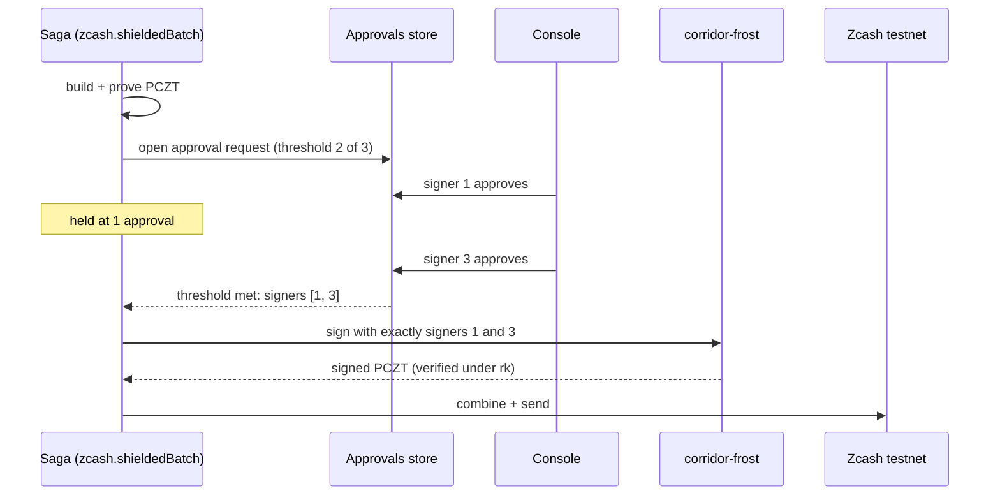

A shielded vault controlled by one key is one stolen laptop away from a loss. Corridor's vaults are controlled by **FROST 2-of-3**: the vault's spend-authorizing key `ak` *is* a FROST group key, so the full spending key never exists anywhere.

## Signers

| Signer | Held by |
|---|---|
| 1 | Customer approver |
| 2 | Customer finance lead |
| 3 | Corridor |

Any two can authorize a batch. One alone is refused, by the code and by the cryptography.

## corridor-frost

A Rust service (`services/zcash-frost`) built on the `reddsa` FROST(RedPallas) ciphersuite with `frost-rerandomized`.

<Steps>
  <Step title="keygen">
    Produces three shares and the vault's public material. The group verifying key must have a positive-y encoding to be a valid Ironwood `ak`, so keygen retries until it does. The full viewing key `ak ‖ nk ‖ rivk` is built with `FullViewingKey::from_bytes` (a public API, no crate fork), and from it the unified full viewing key and the vault address.
    ```bash
    corridor-frost keygen --threshold 2 --signers 3 --network test --out .keys/frost-treasury
    ```
  </Step>
  <Step title="build (zcash-devtool)">
    The view-only wallet imports the UFVK, builds the batch as an unsigned PCZT and proves it.
  </Step>
  <Step title="sign">
    For every unsigned Ironwood action in the PCZT: read its randomizer `alpha`; check `rk == ak + [alpha]G`, so only **this vault's** spends are signed; run both FROST rounds **rerandomized by alpha** over the approving signers; aggregate; verify the RedPallas signature against `rk`; apply it with `Signer::apply_ironwood_signature`. A signer set below the threshold is refused.
    ```bash
    corridor-frost sign --pczt batch.pczt --keys .keys/frost-treasury --signers 1,3 --out signed.pczt
    ```
  </Step>
  <Step title="combine and send (zcash-devtool)">
    Merge the proven PCZT with the signed one and broadcast.
  </Step>
</Steps>

`corridor-frost inspect` lists the Ironwood actions in a PCZT and whether each is signed.

## Why rerandomized

Ironwood (like Orchard) randomizes the spend validating key per action (`rk = ak + [alpha]G`) so spends cannot be linked to a vault on-chain. A threshold signature must therefore be produced under `rk`, not `ak`. FROST rerandomized signing does exactly that, so threshold control costs no privacy.

## Approval flow



## Tests

| Test | Proves |
|---|---|
| `two_of_three_produces_a_valid_rerandomized_spend_auth_signature` | A 2-of-3 rerandomized signature verifies under `rk` |
| `any_two_signers_work_but_one_does_not` | Every pair succeeds; any single signer fails |
| `keygen_writes_a_valid_ironwood_viewing_key_and_address` | The group key yields a valid Ironwood UFVK and address |

## Scope

| | Demo | Production |
|---|---|---|
| Key generation | Trusted dealer | Distributed key generation |
| Rounds | Both rounds in one process over separate share files | Each signer on their own device, relaying through `frostd` |

The PCZT interface and the cryptography are unchanged between the two.

## Evidence

Signer 2 alone was refused; signers 1 + 3 co-signed a batch paying three recipients ([878b44b8…](https://testnet.zcashexplorer.app/transactions/878b44b81d518e5d5333f9d21e5f4d6017c6ce16afbdf484eb7a038b7edd355c)), and a supplier batch was held at one approval in the console until signer 3 approved ([ba4e845b…](https://testnet.zcashexplorer.app/transactions/ba4e845b81b7d6faf350fd01cf967d9d35d717d5bc3eb455eb48ee945b3c38c7)).
