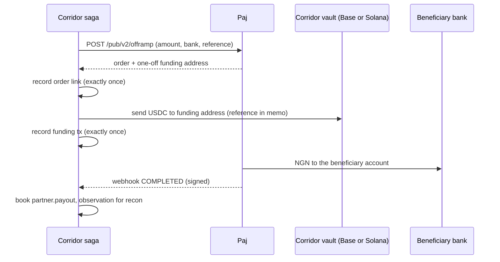

[Paj](https://paj.cash) converts between USDC and Nigerian naira through a business API. Corridor's adapter (`@corridor/partners`, `PajPartner`) is built against Paj's [public API v2 OpenAPI specification](https://docs.paj.cash/api-reference/openapi.json) and implements the [partner interface](/integrations/partner-interface).

## Why Paj

- **Naira both ways:** offramp (USDC → NGN to a bank account) and onramp (NGN into a virtual account → USDC).
- **Settles on Solana.** which is where majority of the USDC transactions are pooled.
- **Signed webhooks** with a timestamped HMAC scheme.
- **Zcash on the roadmap:** `ZCASH` already appears in Paj's chain enum (not yet open), a future path for shielded payouts straight to naira.

## Mapping

| Corridor | Paj API v2 | Notes |
|---|---|---|
| `rates(currency)` | `GET /pub/v2/rate` | On-ramp and off-ramp rates per USD |
| `openPayout(req)` | `POST /pub/v2/offramp` | Returns a **one-off funding address**, valid for 2 hours |
| `openCollection(req)` | `POST /pub/v2/onramp` | Returns a **one-off virtual bank account** for the payer |
| `getOrder(id)` | `GET /pub/v2/transaction/{id}` | Polled as a fallback to webhooks |
| `verifyWebhook` / `parseWebhook` | Webhook delivery | `X-PAJ-Timestamp`, `X-PAJ-Signature: v1=…` |

Requests authenticate with an `x-api-key` header. The Corridor Reference rides in Paj's `description` / `userExternalId` fields and is echoed back on webhooks.

## Status normalisation

| Paj | Corridor |
|---|---|
| `INIT` | `open` |
| `PROCESSING` | `processing` |
| `COMPLETED` | `completed` |
| `ERROR` | `failed` |

## The payout lifecycle

## Mock partner

For testnet, a Paj-shaped mock implements the same lifecycle and signs its webhooks with the same scheme, delivered over real HTTP to Corridor's webhook server. The mock observes real Solana devnet funding when the devnet vault holds USDC.

<Info>
Going live needs a Paj business API key. No code changes: the registry selects `PajPartner` instead of the mock.
</Info>
