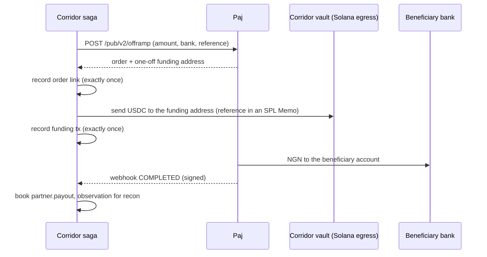

[Paj](https://paj.cash) converts between USDC and Nigerian naira through a business API. Corridor's adapter (`@corridor/partners`, `PajPartner`) is built against Paj's [public API v2 OpenAPI specification](https://docs.paj.cash/api-reference/openapi.json) and implements the same [partner interface](/integrations/partner-interface) a Stellar anchor does.

It is here for one reason: **no licensed naira anchor is live on Stellar**. Until one is, naira is reached through a partner that settles on Solana, and `OFF_STELLAR_PAYOUT_CURRENCIES` is the single list that says so.

## Why it stays

- **Naira both ways:** offramp (USDC → NGN to a bank account) and onramp (NGN into a virtual account → USDC).
- **Settles on Solana**, where its USDC liquidity sits. Base appears in Paj's API but is not live for Corridor, and the adapter refuses Base orders rather than send one Paj cannot fill.
- **Signed webhooks** with a timestamped HMAC scheme — unlike SEP-31, which has no webhook and is polled.
- It is the rail the prototype proved against real money, which is why the naira corridor is the one with a working counterparty and the missing piece is the hop to reach it.

## Mapping

| Corridor | Paj API v2 | Notes |
|---|---|---|
| `rates(currency)` | `GET /pub/v2/rate` | On-ramp and off-ramp rates per USD |
| `openPayout(req)` | `POST /pub/v2/offramp` | Returns a **one-off funding address**, valid for 2 hours |
| `openCollection(req)` | `POST /pub/v2/onramp` | Returns a **one-off virtual bank account** for the payer |
| `getOrder(id)` | `GET /pub/v2/transaction/{id}` | Polled as a fallback to webhooks |
| `verifyWebhook` / `parseWebhook` | Webhook delivery | `X-PAJ-Timestamp`, `X-PAJ-Signature: v1=…` |

Requests authenticate with an `x-api-key` header. The Corridor Reference rides in Paj's `description` / `userExternalId` fields and is echoed back on webhooks.

## Status normalisation

| Paj | Corridor |
|---|---|
| `INIT` | `open` |
| `PROCESSING` | `processing` |
| `COMPLETED` | `completed` |
| `ERROR` | `failed` |

Every provider, anchor or not, is normalised to those four, so the legs and the matcher never depend on one provider's vocabulary.

## Precision

Paj settles in **6-decimal USDC** on Solana, and the hub keeps 7. Amounts convert through `rescale`, which refuses an amount carrying a seventh decimal instead of rounding it away — so a payout that cannot be paid to the stroop fails loudly at the edge.

## The payout lifecycle

The vault that funds the order depends on where the partner settles: an anchor on the hub is paid out of the Stellar treasury, and a partner that settles elsewhere is paid from the egress vault a cross-chain leg filled — and the customer bears those fees.

## Mock partner

For testnet, a Paj-shaped mock implements the same lifecycle and signs its webhooks with the same scheme, delivered over real HTTP to Corridor's webhook server. `pnpm stellar:payout` uses it with `chains: ["STELLAR"]`, so the order lifecycle is the mock's and the Stellar payment is real.

<Info>
Paj was proven against real money in Corridor's earlier **Tempo prototype**: on 11 October 2026 an order paid ₦3,891.48 into a Nigerian bank account, and its narration carried the Corridor Reference. That run is kept as [evidence of the prototype](/status/evidence#the-prototype-on-tempo). Nothing has run through Paj from the Stellar hub, because the hop to reach it — [`cctp.transfer`](/integrations/cctp) — is not built.
</Info>
